# Invoice Management System Lite — AWS SAA Hands-on

既存の Invoice API（ASP.NET Core / Docker / PostgreSQL）を題材に、AWS SAA 学習の実践として、
VPC 設計から EC2、RDS、CloudWatch、ALB までを段階的に構築・検証した記録です。

> **現在の状態**  
> 本ハンズオンは短期検証として完了しており、エビデンス取得後にハンズオン専用の AWS リソースは削除済みです。  
> 以下の構成図・設定内容・スクリーンショットは、削除前の検証時点の構成を記録したものです。

> **目的**  
> 単にサービスを作成するだけではなく、既存の ConoHa VPS 構成と比較しながら、
> AWS におけるネットワーク分離、マネージド DB、IAM Role、監視、ロードバランシングを実際に確認することを目的としています。

## 実施内容

- IAM ユーザー / グループ / MFA の基本操作
- VPC、Public / Private Subnet、Internet Gateway、Route Table の作成
- Security Group による通信経路の制御
- EC2 上への Docker / ASP.NET Core API デプロイ
- EBS の容量拡張
- PostgreSQL を EC2 内 Docker から Amazon RDS for PostgreSQL へ分離
- EC2 → RDS の PostgreSQL 接続確認（TLS）
- EF Core Migration による RDS 上のテーブル作成
- CloudWatch Metrics による EC2 / RDS 監視
- EC2 IAM Role + Docker `awslogs` による CloudWatch Logs 転送
- Application Load Balancer + Target Group の構築
- EC2 への HTTP 直接アクセスを遮断し、ALB 経由のみ許可

## AWS 構成図（検証時）

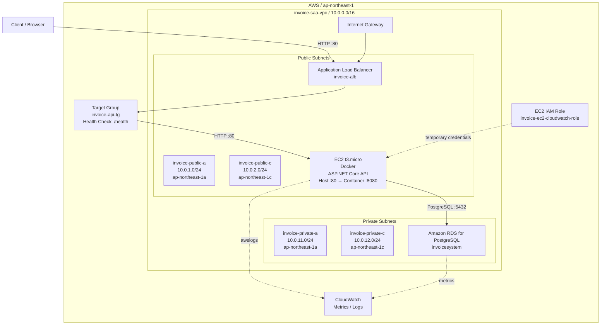

### Security Group の考え方

```text
Internet
   │
   │ HTTP :80
   ▼
invoice-alb-sg
   │
   │ HTTP :80
   ▼
invoice-ec2-sg
   │
   │ PostgreSQL :5432
   ▼
invoice-rds-sg
```

- `invoice-alb-sg`: HTTP 80 を Internet から許可
- `invoice-ec2-sg`: HTTP 80 は `invoice-alb-sg` からのみ許可
- `invoice-rds-sg`: PostgreSQL 5432 は `invoice-ec2-sg` からのみ許可
- SSH 22 は管理元 IP に限定

ALB 経由の `/health` が成功する一方、EC2 の Public IPv4 へ直接 HTTP 接続するとタイムアウトすることを確認し、
ALB を入口とする通信経路に制限しました。

> **可用性について**  
> ALB は 2 つの Public Subnet / AZ に配置していますが、今回の EC2 は 1 台構成です。
> そのため「アプリケーション全体を Multi-AZ 化した構成」ではありません。
> 本格的な高可用性構成にする場合は、複数 AZ の EC2 + Auto Scaling 等を追加する想定です。

## RDS 分離

当初は EC2 上で API と PostgreSQL コンテナを同居させていました。

```text
Before

EC2
├─ ASP.NET Core API container
└─ PostgreSQL container
```

RDS 分離後は以下の構成に変更しました。

```text
After

EC2
└─ ASP.NET Core API container
        │
        └── TCP 5432 / TLS
                │
                ▼
        Amazon RDS for PostgreSQL
```

RDS 側へ接続後、EF Core Migration により `__EFMigrationsHistory` を含む 12 テーブルが作成されたことを確認しました。
その後 EC2 内の PostgreSQL コンテナを停止し、API の `/health` が引き続き `Healthy` を返すことを確認しています。

## CloudWatch

### Metrics

EC2 では `CPUUtilization`、RDS では `DatabaseConnections` 等を確認しました。

- EC2: CPU 使用率
- RDS: DB 接続数
- RDS: CPU / Memory / Storage 系メトリクス

### Logs

EC2 に IAM Role `invoice-ec2-cloudwatch-role` を付与し、アクセスキーを EC2 内に保存せず、
Docker の `awslogs` logging driver を利用して ASP.NET Core のログを CloudWatch Logs へ転送しました。

```text
Invoice API container
        │
        │ awslogs
        ▼
CloudWatch Logs
/invoice-saa/api
└─ invoice-api-ec2
```

CloudWatch Logs 上で `Starting InvoiceSystem.Api` および `/health` の HTTP 200 ログを確認しています。

## ConoHa VPS vs AWS

| 観点 | ConoHa VPS 構成 | AWS ハンズオン構成 |
|---|---|---|
| API 実行基盤 | VPS 上の Docker | EC2 上の Docker |
| DB | VPS 上の PostgreSQL Docker | Amazon RDS for PostgreSQL |
| 外部入口 | nginx リバースプロキシ | Application Load Balancer |
| ネットワーク | 1 台の VPS を中心に構成 | VPC / Public / Private Subnet に分離 |
| FW / アクセス制御 | UFW + Docker / nginx 設定 | Security Group |
| DB の公開範囲 | VPS 内の構成に依存 | RDS は Private 側、EC2 SG から 5432 のみ |
| HTTPS | nginx + Certbot | 今回の ALB 検証は HTTP のみ |
| 監視 | Linux / Docker ログ中心 | CloudWatch Metrics / Logs |
| AWS 認証 | 該当なし | EC2 IAM Role / 一時認証情報 |
| 可用性 | 基本 1 サーバー | ALB は 2 AZ、EC2 は 1 台 |
| 運用の単純さ | 比較的シンプル | サービス分離により構成要素が増える |
| コスト特性 | 月額を把握しやすい | EC2 / RDS / ALB 等の利用量・時間で変動 |
| 学習テーマ | Linux / Docker / nginx 運用 | IAM / VPC / RDS / CloudWatch / ELB |

### 比較して分かったこと

**ConoHa VPS**

- 小規模構成では API・DB・nginx を 1 台に集約でき、構成が分かりやすい
- 固定費を把握しやすく、個人開発の常時公開に向いている
- DB、監視、冗長化などを自分で設計・運用する割合が大きい

**AWS**

- VPC、Subnet、Security Group によって役割ごとにネットワークを分離できる
- RDS や ALB、CloudWatch などのマネージドサービスを組み合わせられる
- IAM Role によって EC2 に長期 Access Key を配置せず AWS サービスへアクセスできる
- 構成要素と料金ポイントが増えるため、用途に応じた設計と削除・停止管理が必要

## 実施エビデンス

以下のスクリーンショットは、AWS リソース削除前に取得した検証時点の証跡です。

公開用スクリーンショットでは、AWS アカウント ID、ARN、各種リソース ID、Public IP / DNS、
RDS Endpoint 等、構成説明に不要な識別情報をマスキングしています。
パスワード、Secret Key、JWT Key、SSH 秘密鍵、MFA Secret 等は掲載していません。

### IAM

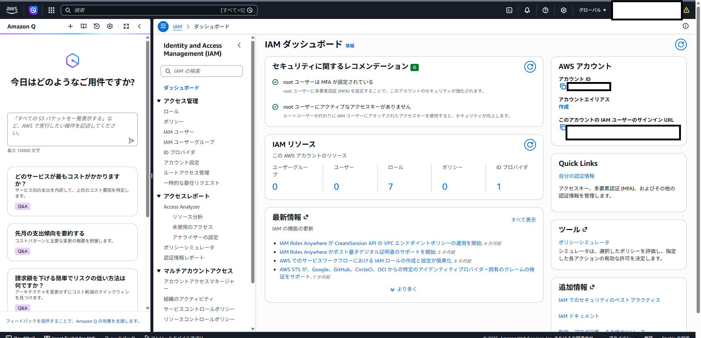

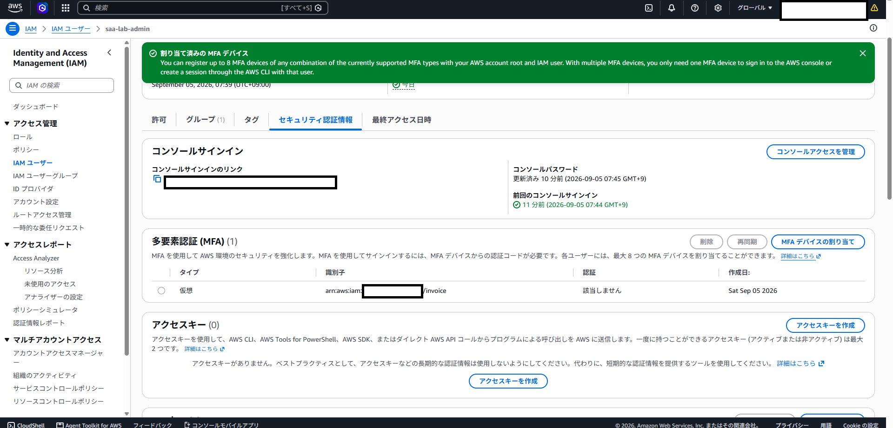

### VPC / Security Group

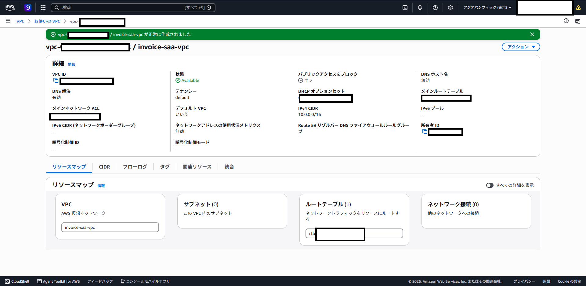

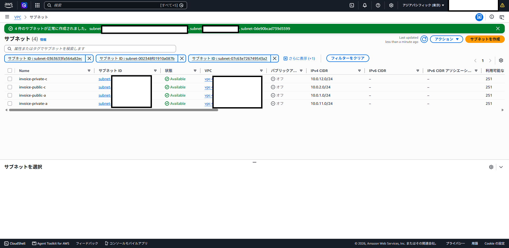

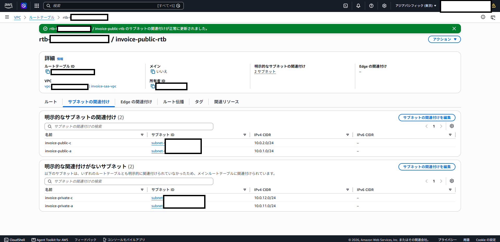

### RDS

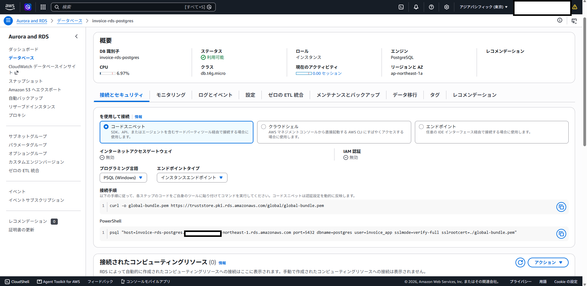

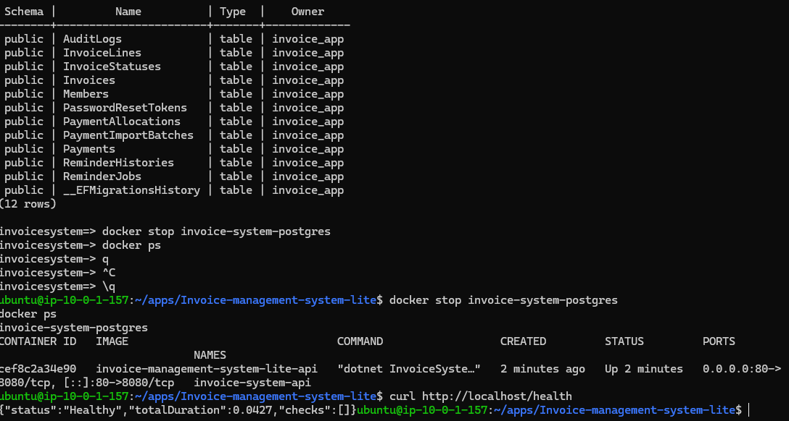

### CloudWatch

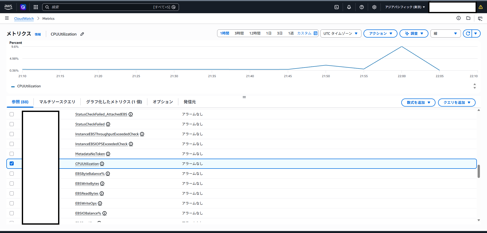

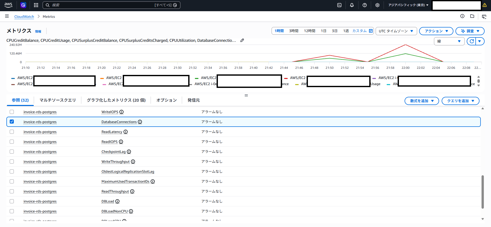

### IAM Role / CloudWatch Logs

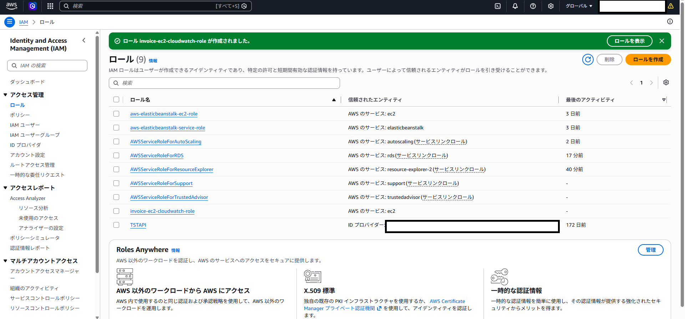

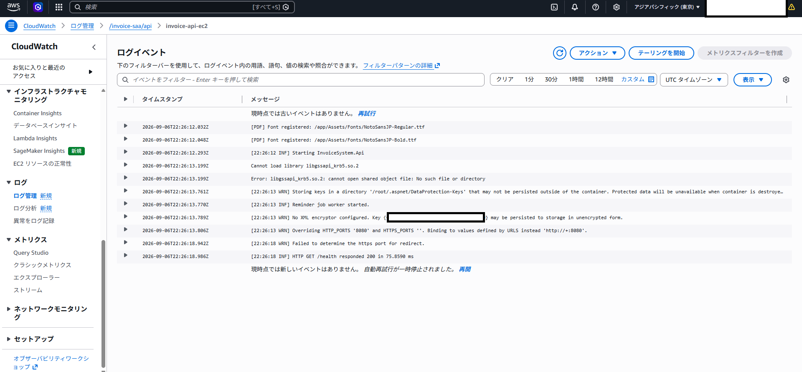

### ALB

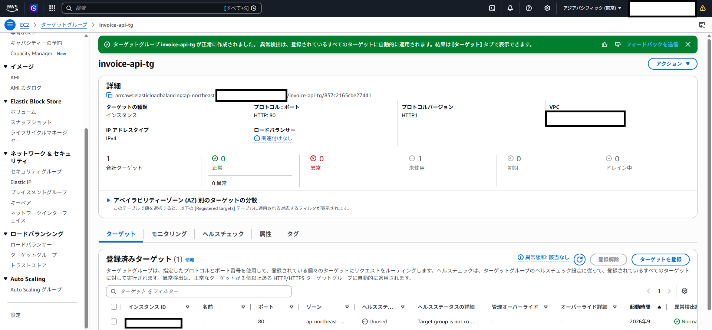

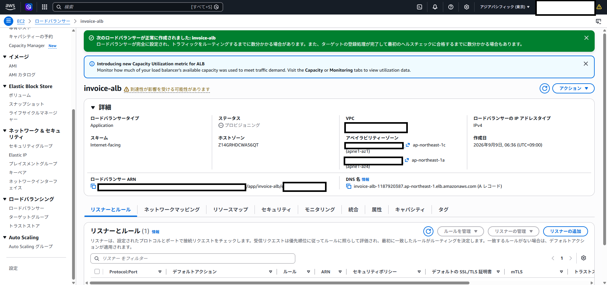

## 動作確認

以下のインフラ経路について動作確認済みです。

- EC2 内部から API `/health` → `Healthy`
- EC2 → RDS PostgreSQL → TLS 接続成功
- RDS に EF Core Migration のテーブル作成
- EC2 内 PostgreSQL コンテナ停止後も API `/health` → `Healthy`
- CloudWatch Logs に API 起動ログ / `/health 200` を転送
- ALB DNS → `/health` → `Healthy`
- EC2 Public IPv4 → `/health` → 接続タイムアウト（ALB 経由のみに制限）

## 検証時の補足

AWS インフラの疎通確認とは別に、検証中に一部の MyAccount 系 API で `404` を確認しました。

```text
GET /api/members/me/invoices/with-balance
GET /api/members/me/invoices/{id}
```

Swagger 上では対象 Endpoint が公開されており、ALB 経由で Swagger UI / `/health` への到達も確認できていたため、
VPC / Security Group / ALB の疎通問題とは切り分けています。

本ハンズオンでは AWS インフラ構築・監視・通信経路の検証を完了条件とし、
この事象はアプリケーション側のデータ条件・認証・実装に関する別確認事項として扱いました。
AWS の検証環境は証跡取得後に削除済みです。

## SAA 学習上のポイント

今回のハンズオンで特に確認できた内容です。

- IAM User と IAM Role の用途の違い
- EC2 から AWS サービスへアクセスするときは IAM Role を利用する
- Public / Private Subnet の役割
- Security Group を別 Security Group から参照する構成
- EC2 と RDS の分離
- RDS をインターネットへ直接公開しない構成
- CloudWatch Metrics と CloudWatch Logs の違い
- ALB / Target Group / Health Check の関係
- ALB が 2 AZ でも、EC2 が 1 台ならアプリ全体の高可用性にはならない
- 検証用リソースはエビデンス取得後に削除し、不要な継続課金を避ける

## 後片付け

本ハンズオンは短期検証を目的として実施しました。
必要なエビデンス取得後、不要な継続課金を避けるため、ハンズオン専用の AWS リソースを削除しました。

削除対象は以下のとおりです。

- Application Load Balancer `invoice-alb`
- Target Group `invoice-api-tg`
- Amazon RDS for PostgreSQL
- RDS の検証用スナップショット / DB Subnet Group
- EC2 インスタンス / EBS
- CloudWatch Logs `/invoice-saa/api`
- EC2 用 IAM Role `invoice-ec2-cloudwatch-role`
- ハンズオン用 Security Group
- `invoice-saa-vpc`
- Public / Private Subnet
- Route Table / Internet Gateway など、ハンズオン用 VPC に属するネットワークリソース

構築内容については、本 README とマスキング済みスクリーンショットを証跡として保存しています。
AWS 上には本ハンズオンの検証環境を常設していません。

> **コスト確認について**  
> AWS の料金情報には反映遅延があるため、削除後も Billing / Cost Explorer を確認し、
> EC2 / RDS / Elastic Load Balancing 等の利用量・コストが継続的に増えていないことを確認します。

